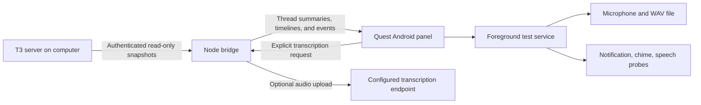

# Prototype design and limits

The prototype isolates the Quest behaviors that determine whether a voice companion is practical during standalone Beat Saber.

## Android behavior

`MainActivity` is an Android 2D panel with a packaged WebView for the thread sidebar. It has a standard launcher entry and an overlay launcher category. It declares no immersive VR activity. Horizon OS owns the panel's placement and input focus alongside Beat Saber.

The panel requests a 420 × 480 dp default window and permits 320 × 300 dp or larger. Threads, Connect, and Test have separate scrollable pages. The colors come from T3 Code's shared dark palette. Attribution and the upstream MIT license ship in the APK assets.

`MainActivity` is a `ComponentActivity` with a Meta Layout SDK `SpatialScene`. Its native list, connection, and test views remain in one `AndroidView` in the primary window. `ReadingWindowHost` conditionally emits one `SpatialWindow` with the stable key `thread-reader`, a 1000 × 780 dp size, `WindowAnchor.Center`, and `OffsetStep.Near` on the z axis. Opening another thread inside the reader reuses that window.

The child has its own `ThreadWebView` and read-only `ThreadController`, created with the child window's context. Back removes the child; disposal cancels polling and destroys its WebView. The list document remains mounted underneath. External window dismissal also returns to the list. Unsupported devices, terminal placement failures, and capacity/preemption states fall back to the existing in-panel conversation path. This fallback never launches another task.

The former separate-task transition used `LAUNCH_ADJACENT`, which moved the conversation beside the original panel. Version 0.3.1 removed that path. Version 0.4.0 adds the Layout SDK child without restoring the separate activity or changing the primary window's bounds. The center anchor is a placement request. The user verified centered opening and return to the unchanged compact panel during Beat Saber on Quest 3.

The panel polls the configured bridge while its activity is resumed, even without a test. Pausing the activity stops that polling. The foreground service handles polling and alerts during a timed test.

`ProbeService` starts from a visible user action, after permission checks. It enters the foreground with microphone and media playback service types, records for at most three minutes, and releases the microphone when the session ends. The service is not sticky and does not restart recording after process death.

`WavCapture` writes 16 kHz mono PCM16 audio. Each second it logs RMS energy, the Android silence flag, and whether the panel has focus. The app can compare the `MIC` and `VOICE_COMMUNICATION` audio sources.

The notification probe uses Android `NotificationManager`. The chime is a separate `ToneGenerator` request on the music stream without requesting audio focus. Spoken output uses an installed Android text-to-speech engine. Quest may suppress notifications, sounds, microphone input, or the service. These are measurements for the headset test, not promised capabilities.

## T3 integration

The initial adapter requests a bearer session through `/oauth/token` with `orchestration:read`. It reads `/api/orchestration/shell` with the `x-t3-orchestration-protocol: 2` header. It reads bounded conversation projections and cursor-based activity history over HTTP. Full tool output uses a short-lived WebSocket ticket and the single `orchestration.getTurnItem` read RPC. The bridge exposes no generic RPC forwarding or thread mutation endpoint.

The first snapshot establishes a baseline. Later snapshots emit alerts for a completed run, a failed run, or a new pending input request. Active runs and pending background tasks prevent a thread from being labeled finished. Repeated snapshots do not repeat the same alert.

The adapter was implemented against the local T3 checkout at commit `bed923986fbcbe8279f23b9367efde1596bde1f9`. These are T3's internal client interfaces. An incompatible server update may require changing the adapter.

T3 Connect is a cloud identity and tunnel system. It is not the name of Tailscale's protocol. Direct pairing, Tailscale, and T3 Connect ultimately reach the same environment API, but their credential acquisition differs. A future cloud client should reuse T3's shared connection runtime for Clerk and DPoP rather than imitate cloud login.

## Data handling

The computer bridge listens on loopback by default. Wi-Fi testing explicitly enables LAN access. Every endpoint requires the bridge token, and requests with browser `Origin` headers are rejected. The bridge does not allow arbitrary RPC forwarding or thread mutations.

The prototype permits cleartext HTTP for local testing. Use a trusted private network. Do not expose the bridge's HTTP port to the public internet. T3 public endpoints require HTTPS in the pairing helper. The bridge refuses redirects when sending credentials or audio.

The USB setup helper writes the bridge address and token through ADB stdin into an app-private file using `run-as`. The app imports and removes that file. Credentials do not enter command arguments or logs. The helper requires the debug APK and an authorized USB connection. It binds the bridge to the selected laptop address.

The app's recording and log stay in its private files directory. Backup is disabled. Transcription is optional and requires a user upload action. A production client needs credential storage hardening, HTTPS provisioning, reconnect tests, and a longer device soak test.

## Conversation rendering

The packaged renderer uses Marked for Markdown and DOMPurify with an explicit allowlist. A restrictive content policy and native request interceptor block external resources. Credentials remain in Java and the laptop bridge. Links require an explicit click and browser confirmation; file links remain on the laptop. Images and attachments are labels in this version.

Completed turns fold commentary and tool activity before the final assistant reply. Earlier pages merge by source item identity and position. A live refresh retains loaded older history, expanded disclosures, and the reading anchor. Output is hydrated on request through the read-only item RPC. Threads pause polling when the activity pauses; timed test notifications remain separate.

## Next decision

If the panel, alert, and microphone tests pass during a song, add a reviewed send action through T3's command API. Then evaluate push-to-talk or wake-word activation. If hidden-panel capture fails, retain voice input while the panel is focused and use it between songs.

Platform references:

- [Horizon OS panel sizing and multi-panel activity flags](https://developers.meta.com/vr/documentation/android-apps/features-overview/)

- [Meta Android app manifest requirements](https://developers.meta.com/vr/documentation/android-apps/port-an-existing-app/)
- [Meta background audio support](https://developers.meta.com/vr/documentation/android-apps/features-overview/)
- [Meta known audio issues](https://developers.meta.com/vr/documentation/spatial-sdk/spatial-sdk-known-issues/)
- [Android microphone foreground services](https://developer.android.com/develop/background-work/services/fgs/service-types#microphone)
- [T3 authentication contracts](https://github.com/pingdotgg/t3code/blob/bed923986fbcbe8279f23b9367efde1596bde1f9/packages/contracts/src/auth.ts)
- [T3 HTTP contracts](https://github.com/pingdotgg/t3code/blob/bed923986fbcbe8279f23b9367efde1596bde1f9/packages/contracts/src/environmentHttp.ts)

- [Meta Layout SDK anchors and offsets](https://developers.meta.com/vr/documentation/android-apps/meta-vr-layout-anchors/)
